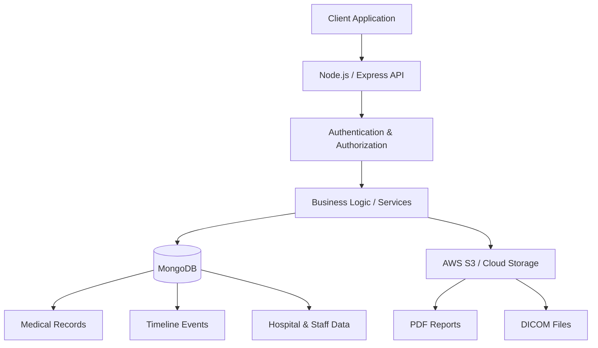

# Coopit — Healthcare Workflow & Medical Timeline Platform

> **A centralized healthcare platform designed to maintain continuity of patient medical records across hospital visits, healthcare professionals, and diagnostic workflows.**

[](https://coopit.onrender.com)
[](https://github.com/VIKRANTBHATT27/Coopit)


---

## Table of Contents

- [Overview](#overview)
- [Problem Statement](#problem-statement)
- [Core Idea](#core-idea)
- [Key Features](#key-features)
- [System Architecture](#system-architecture)
- [Application Workflow](#application-workflow)
- [Technology Stack](#technology-stack)
- [Database Design](#database-design)
- [API Structure](#api-structure)
- [Security & Access Control](#security--access-control)
- [File Storage](#file-storage)
- [Project Structure](#project-structure)
- [Getting Started](#getting-started)
- [Environment Variables](#environment-variables)
- [Testing](#testing)
- [Current Status](#current-status)
- [Future Improvements](#future-improvements)
- [Contributing](#contributing)
- [License](#license)

---

## Overview

Coopit is a healthcare workflow and medical timeline platform built to improve continuity of patient medical records.

Traditional healthcare workflows often leave patient information fragmented across hospitals, departments, paper records, and disconnected digital systems.

Coopit aims to organize patient medical history into a chronological timeline, allowing authorized healthcare professionals to access relevant records and understand a patient's medical journey.

The platform models healthcare activities as structured events, from patient registration and clinical checkups to laboratory reports and diagnostic uploads.

## Problem Statement

Patient medical information is frequently scattered across different healthcare providers and departments.

This creates several challenges:

- Patients may not have their previous medical reports readily available.
- Doctors may lack access to a patient's complete medical history.
- Diagnostic reports may arrive separately from the original consultation.
- Healthcare professionals may struggle to track previous treatments and clinical progress.
- Repeated consultations can result in fragmented medical documentation.

Coopit aims to address these problems through a centralized, event-driven medical record system.

## Core Idea

### Medical Timeline — Every Checkup Is a Record

Coopit organizes a patient's medical journey chronologically.

Rather than treating medical records as isolated documents, the platform records healthcare activities as timeline events.

Example:

```text
January 02
  └── Patient Checkup
      ├── Symptoms recorded
      ├── Vitals documented
      └── Treatment prescribed

January 04
  └── Laboratory Report Uploaded
      └── Blood Test PDF

January 06
  └── Diagnostic File Uploaded
      └── CT Scan / DICOM

January 07
  └── Follow-up Checkup
      └── Treatment Updated
```

This approach allows medical history to evolve as new information becomes available without silently overwriting previous clinical records.

## Key Features

> Update this section as features become functional.

- [ ] Patient registration and profile management
- [ ] Hospital and staff management
- [ ] Role-based authentication and authorization
- [ ] Patient visit and appointment workflow
- [ ] Nurse-led clinical checkup documentation
- [ ] Doctor-supervised medical records
- [ ] Chronological medical timeline
- [ ] Medical case and disease history tracking
- [ ] Laboratory test instructions
- [ ] Laboratory report uploads
- [ ] DICOM medical imaging file management
- [ ] Secure medical document access
- [ ] Patient follow-up tracking
- [ ] Hospital-level administration

## System Architecture

### High-Level Architecture



### Architectural Principles

- **Separation of concerns:** Controllers, services, middleware, and models have distinct responsibilities.
- **Role-based access:** Permissions depend on the authenticated user's role and resource ownership/context.
- **Event-driven timeline:** Medical activities are represented as chronological events.
- **Secure file handling:** Actual medical files are stored separately from database metadata.
- **Historical continuity:** New medical information is added without silently replacing previous records.

## Application Workflow

### 1. Patient Registration

A receptionist registers a patient or retrieves an existing patient profile.

### 2. Visit Creation

A visit is created with relevant information:

- Patient
- Assigned doctor
- Assigned nurse
- Reason for visit
- Visit status

### 3. Clinical Checkup

The nurse records relevant clinical information, including:

- Symptoms
- Vital signs
- Clinical observations
- Other checkup details

The doctor supervises the encounter and is responsible for the medical record.

### 4. Treatment & Laboratory Instructions

The doctor documents treatment plans and requests diagnostic tests when required.

### 5. Report Upload

Laboratory technicians upload diagnostic reports and associated files.

These uploads can happen after the original checkup.

### 6. Timeline Update

New activities are recorded as timeline events, preserving the chronological medical history.

## Technology Stack

| Layer | Technology |
|---|---|
| Frontend | React, Tailwind CSS |
| Backend | Node.js, Express.js |
| Database | MongoDB, Mongoose |
| Authentication | JWT, bcrypt |
| Validation | Zod |
| API Testing | Postman / Hoppscotch |
| File Storage | AWS S3 / Google Cloud Storage |
| Deployment | Render / Vercel |
| Notifications | Twilio / SendGrid |

*Adjust this list to include only technologies currently implemented.*

## Database Design

Coopit uses separate entities to represent healthcare users, hospital workflows, clinical encounters, and medical history.

| Entity | Responsibility |
|---|---|
| User | Authentication and base identity |
| Hospital | Hospital information and administration |
| Staff | Hospital employment and membership |
| Doctor | Doctor-specific information |
| Nurse | Nurse-specific information |
| Receptionist | Reception and registration information |
| LabTechnician | Laboratory staff information |
| Patient | Patient profile |
| Visit | Operational patient encounter and queue |
| MedicalCase | Longitudinal disease or condition episode |
| Checkup | Clinical encounter record |
| TimelineEvent | Chronological medical activity |
| LabReport | Laboratory report metadata |
| DICOM | Medical imaging metadata |

### Important Domain Distinctions

- **Visit:** Represents the operational hospital encounter.
- **Checkup:** Represents the clinical documentation for an encounter.
- **MedicalCase:** Groups related medical encounters over time.
- **TimelineEvent:** Represents an activity in the patient's medical history.
- **LabReport / DICOM:** Represent diagnostic records and associated file metadata.

## API Structure

The backend exposes REST APIs organized around application resources.

Example endpoint groups:

| Resource | Responsibility |
|---|---|
| `/api/auth` | Authentication |
| `/api/users` | User management |
| `/api/hospitals` | Hospital management |
| `/api/staff` | Hospital staff management |
| `/api/patients` | Patient profiles |
| `/api/visits` | Patient visit workflow |
| `/api/checkups` | Clinical checkup records |
| `/api/medical-cases` | Longitudinal medical cases |
| `/api/timeline` | Medical timeline events |
| `/api/lab-reports` | Laboratory report management |
| `/api/dicom` | Medical imaging management |

*Replace these examples with your actual registered routes.*

## Security & Access Control

Coopit handles sensitive medical information, so access control is an important part of the backend architecture.

Security mechanisms include:

- JWT-based authentication.
- Password hashing using bcrypt.
- Input validation using Zod.
- Role-based authorization.
- Resource-level access checks.
- Private cloud storage for medical documents.
- Short-lived signed URLs for authorized file access.

### Authorization Flow

```text
Incoming Request
      |
      v
Authentication Middleware
      |
      v
Role / Permission Middleware
      |
      v
Controller
      |
      v
Service Layer
      |
      v
Resource-Level Access Check
      |
      v
Database / Storage Operation
```

The service layer is responsible for determining whether a particular authenticated user can access a specific resource, rather than relying solely on role checks.

## File Storage

Medical documents and imaging files are stored separately from application data.

```text
MongoDB
  └── File metadata
       ├── Patient ID
       ├── Report ID
       ├── Storage key
       └── Upload information

Cloud Object Storage
  └── Actual medical files
       ├── PDF reports
       └── DICOM files
```

The backend controls access to private files and generates temporary signed URLs when an authorized user requests them.

## Project Structure

```text
Coopit/
│
├── client/
│   ├── src/
│   │   ├── components/
│   │   ├── pages/
│   │   ├── hooks/
│   │   ├── services/
│   │   └── utils/
│   └── package.json
│
├── server/
│   ├── src/
│   │   ├── config/
│   │   ├── controllers/
│   │   ├── middleware/
│   │   ├── models/
│   │   ├── routes/
│   │   ├── services/
│   │   ├── validators/
│   │   └── utils/
│   └── package.json
│
├── docs/
│   ├── architecture.md
│   ├── database.md
│   ├── api.md
│   └── workflows.md
│
├── .gitignore
└── README.md
```

*Adjust the directory tree to match the actual repository.*

## Getting Started

### Prerequisites

- Node.js
- npm
- MongoDB
- Git

### 1. Clone the Repository

```bash
git clone https://github.com/VIKRANTBHATT27/Coopit.git
cd Coopit
```

### 2. Install Dependencies

```bash
cd server
npm install
```

If the frontend is available:

```bash
cd ../client
npm install
```

### 3. Configure Environment Variables

Create a `.env` file inside the backend directory and configure the required variables.

See [Environment Variables](#environment-variables).

### 4. Start the Backend

```bash
npm run dev
```

### 5. Start the Frontend

```bash
npm run dev
```

*Update commands according to the scripts defined in your package.json files.*

## Environment Variables

Example configuration:

```env
PORT=
NODE_ENV=

MONGODB_URI=

JWT_SECRET=
JWT_EXPIRES_IN=

AWS_ACCESS_KEY_ID=
AWS_SECRET_ACCESS_KEY=
AWS_REGION=
AWS_BUCKET_NAME=

SENDGRID_API_KEY=
TWILIO_ACCOUNT_SID=
TWILIO_AUTH_TOKEN=
```

Never commit actual credentials, API keys, tokens, or production secrets to GitHub.

## Testing

Testing is performed using API testing tools such as Postman and Hoppscotch.

Important test areas:

- [ ] Authentication and token validation
- [ ] Request validation and error handling
- [ ] Role-based authorization
- [ ] Resource-level access control
- [ ] Hospital and staff workflows
- [ ] Patient registration and visit creation
- [ ] Checkup creation and retrieval
- [ ] Timeline event creation and retrieval
- [ ] Laboratory report uploads
- [ ] DICOM access permissions
- [ ] Invalid and unauthorized requests

## Current Status

Coopit is under active development.

The project is being developed incrementally, with emphasis on backend architecture, healthcare domain modeling, access control, and medical timeline functionality.

Update this section with the actual implementation status before publishing.

## Future Improvements

Potential improvements include:

- Complete frontend integration.
- Automated backend integration tests.
- Improved hospital administration workflows.
- More granular permission management.
- Real-time workflow updates.
- Enhanced medical timeline visualization.
- Audit logging and historical corrections.
- Improved deployment and monitoring.

## Contributing

Contributions, suggestions, and feedback are welcome.

For major changes, please open an issue first to discuss the proposed change.

## License

Specify your project's license here.

If you have not selected one, do not claim the repository is open-source under a particular license yet.

---

**Coopit — Building continuity into healthcare.**